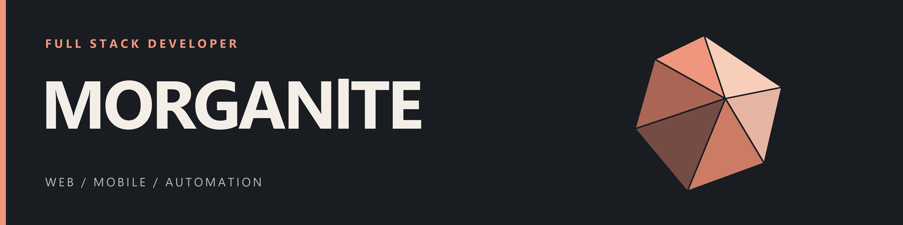

  

  <a href="#highlighted-projects">Highlighted projects</a> &nbsp;·&nbsp;
  <a href="#tech-stack">Tech stack</a> &nbsp;·&nbsp;
  <a href="#ai--automation">AI & automation</a> &nbsp;·&nbsp;
  <a href="https://github.com/MORGANlTE?tab=repositories">All repositories</a>

<h2 align="center" id="highlighted-projects">Highlighted projects</h2>

<table width="100%">
  <tr>
    <td align="center" width="56"></td>
    <td><a href="https://github.com/MORGANlTE/Lil-alchemist-R-bot"><strong>Community Discord bot</strong></a> A Python bot with lookup commands, trivia, and image generation for a community of nearly 10,000 people.</td>
  </tr>
  <tr>
    <td align="center" width="56"></td>
    <td><a href="https://github.com/MORGANlTE/selfhosted-user-emojis-for-free"><strong>Selfhosted User Emojis</strong></a> Custom Discord emojis with a self-hosted Python backend and a Vencord plugin.</td>
  </tr>
  <tr>
    <td align="center" width="56"></td>
    <td><a href="https://github.com/MORGANlTE/notebooklm-latex-extension"><strong>NotebookLM LaTeX Extension</strong></a> Renders mathematical notation in NotebookLM using KaTeX.</td>
  </tr>
  <tr>
    <td align="center" width="56"></td>
    <td><a href="https://github.com/MORGANlTE/CleanYourSmartwatch"><strong>CleanMyWatch</strong></a> Experimental Samsung Wear OS auditing and battery measurement tools.</td>
  </tr>
</table>

<h2 align="center" id="tech-stack">Tech stack</h2>

<table width="100%">
  <tr><th colspan="5" align="center">Languages</th></tr>
  <tr>
    <td align="center" width="20%"> C#</td>
    <td align="center" width="20%"> Java</td>
    <td align="center" width="20%"> JavaScript</td>
    <td align="center" width="20%"> Python</td>
    <td align="center" width="20%"> Kotlin</td>
  </tr>
  <tr><th colspan="5" align="center">Web & mobile</th></tr>
  <tr>
    <td align="center" width="20%"> HTML</td>
    <td align="center" width="20%"> CSS</td>
    <td align="center" width="20%"> React / React Native</td>
    <td align="center" width="20%"> Next.js</td>
    <td align="center" width="20%"> Tailwind CSS</td>
  </tr>
  <tr><th colspan="5" align="center">Backend & cloud</th></tr>
  <tr>
    <td align="center" width="20%"> Node.js</td>
    <td align="center" width="20%"> Express</td>
    <td align="center" width="20%"> .NET / ASP.NET Core</td>
    <td align="center" width="20%"> FastAPI</td>
    <td align="center" width="20%"> Firebase</td>
  </tr>
  <tr><th colspan="5" align="center">Databases & containers</th></tr>
  <tr>
    <td align="center" width="20%"> MySQL</td>
    <td align="center" width="20%"> PostgreSQL</td>
    <td align="center" width="20%"> MongoDB</td>
    <td align="center" width="20%"> SQLite</td>
    <td align="center" width="20%"> Docker</td>
  </tr>
  <tr><th colspan="5" align="center">Tools & environment</th></tr>
  <tr>
    <td align="center" width="20%"> Linux / TUXEDO OS</td>
    <td align="center" width="20%"> Git</td>
    <td align="center" width="20%"> GitHub Actions</td>
    <td align="center" width="20%"> Android Studio</td>
    <td align="center" width="20%"> Unity</td>
  </tr>
</table>

<h2 align="center" id="ai--automation">AI &amp; automation</h2>

<table width="100%">
  <tr>
    <td align="center" width="20%"> ChatGPT</td>
    <td align="center" width="20%"> Codex</td>
    <td align="center" width="20%"> GitHub Copilot</td>
    <td align="center" width="20%"> Ollama</td>
    <td align="center" width="20%"> MCP</td>
  </tr>
</table>

