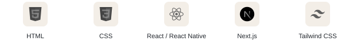
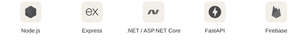
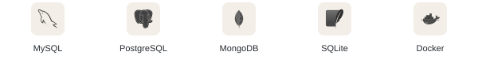
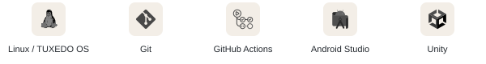

  

  <a href="#highlighted-projects">Highlighted projects</a> &nbsp;·&nbsp;
  <a href="#tech-stack">Tech stack</a> &nbsp;·&nbsp;
  <a href="https://github.com/MORGANlTE?tab=repositories">All repositories</a>

 

<h2 align="center" id="highlighted-projects">Highlighted projects</h2>

   
  <a href="https://github.com/MORGANlTE/Lil-alchemist-R-bot"><strong>Little Alchemist Community Bot</strong></a> 
  A Python Discord bot for the Little Alchemist community of nearly 10,000 members. 
  Card lookups, trivia, and custom image generation.

   
  <a href="https://github.com/MORGANlTE/selfhosted-user-emojis-for-free"><strong>Selfhosted User Emojis</strong></a> 
  Custom Discord emojis with a self-hosted Python backend and a Vencord plugin.

   
  <a href="https://github.com/MORGANlTE/notebooklm-latex-extension"><strong>NotebookLM LaTeX Extension</strong></a> 
  Renders inline and display mathematics in NotebookLM using KaTeX.

   
  <a href="https://github.com/MORGANlTE/CleanYourSmartwatch"><strong>CleanMyWatch</strong></a> 
  Experimental Samsung Wear OS auditing and battery measurement tools.

 

<h2 align="center" id="tech-stack">Tech stack</h2>

<h3 align="center">Languages</h3>

  <picture>
    <source media="(prefers-color-scheme: dark)" srcset="./assets/rows/languages-dark.svg">
    
  </picture>

<h3 align="center">Web &amp; mobile</h3>

  <picture>
    <source media="(prefers-color-scheme: dark)" srcset="./assets/rows/web-mobile-dark.svg">
    
  </picture>

<h3 align="center">Backend &amp; cloud</h3>

  <picture>
    <source media="(prefers-color-scheme: dark)" srcset="./assets/rows/backend-cloud-dark.svg">
    
  </picture>

<h3 align="center">Databases &amp; containers</h3>

  <picture>
    <source media="(prefers-color-scheme: dark)" srcset="./assets/rows/databases-containers-dark.svg">
    
  </picture>

<h3 align="center">Tools &amp; environment</h3>

  <picture>
    <source media="(prefers-color-scheme: dark)" srcset="./assets/rows/tools-environment-dark.svg">
    
  </picture>

<h3 align="center" id="ai--automation">AI &amp; automation</h3>

  <picture>
    <source media="(prefers-color-scheme: dark)" srcset="./assets/rows/ai-automation-dark.svg">
    
  </picture>

